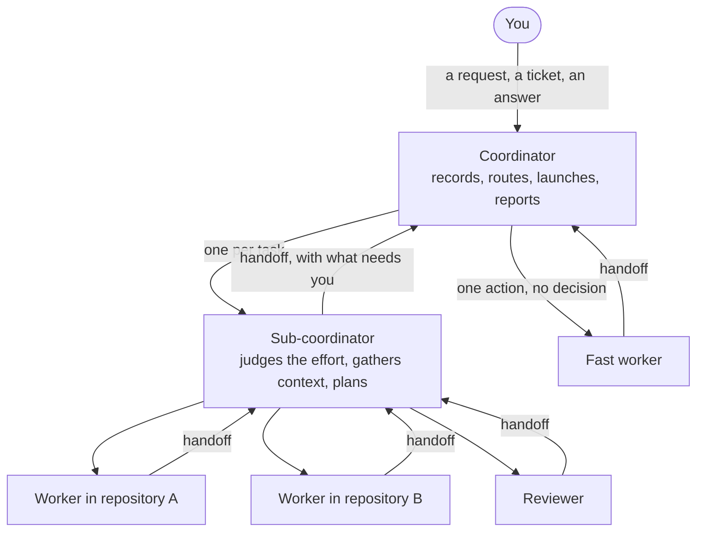

# Coordinator

One agent thread you talk to, which turns each request into a tracked task and delegates the work to other agents started inside the right project folders.
It keeps a written record of every task, passes your words on unchanged, and stops for you only at two gates: agreeing a complex task before work starts, and reviewing the result before anything goes public.
It is a folder of instructions, shell scripts and tests, not a service: any terminal agent that reads `AGENTS.md` can be the coordinator, and nothing keeps running unless you start it.

## How the work is split



- **Coordinator**: the thread you talk to. It finds the task your message belongs to, appends the message exactly as written, launches or messages one agent, answers with a receipt of a few lines and is free again. It never writes product code, and a hook (`scripts/guard.sh`) warns it when it tries to do work itself.
- **Sub-coordinator**: one thread per task, reused for every later round of that task. It reads the ticket, judges the effort, prepares the questions for gate one, launches workers and waits for them. You can also type into its thread directly.
- **Worker**: an agent started inside one repository for one part of the work. A fast worker is a worker the coordinator starts directly for a single, fully specified action (a push, finding a link).
- At most three levels: coordinator, sub-coordinator, worker.

The design is in `docs/design.md`; the rules every agent follows are in `AGENTS.md`, and the steps for each moment are in `playbooks/`.

## Install from a clone

```sh
git clone <this repository> coordinator
cd coordinator
scripts/setup.sh --check   # what is missing; changes nothing
scripts/setup.sh           # safe to run again at any time
```

Requirements: bash 3.2 or later, git, the usual POSIX tools and `shasum` or `sha256sum`.
Optional: Python 3 (only for the panel), Docker (container readings), the T3 Code app (`runtimes/t3.md`), a browser automation tool (`scripts/browser.sh` wraps it), and at least one agent CLI.

`setup.sh` creates the private folder `.private/` from the tracked examples in `config/`, points git at the tracked `hooks/`, seeds the private term list with what the machine can tell (your user name, home path, host name, git identity, routed folders and their remotes), detects the installed providers, and ends with `decide:` lines.
Those are the decisions only you can make: which folders are company, which account each provider is signed in with, and the private terms it cannot discover (asked until the list holds one term setup did not discover itself).
A tool installed in a known place outside PATH (such as `~/.t3/bin`) is found and used, and setup prints the line to add to your shell profile; it never edits the profile.
If the agent running setup is sandboxed and cannot write the git config, setup prints the command for you to run.

Then open the folder in your agent and say "set up the coordinator": the `coordinator-setup` skill (in `.agents/skills/` and `.claude/skills/`) runs the script and asks you those decisions in one message, following `playbooks/setup.md`.

## The first task

Open the folder in an agent and describe a task, or paste a ticket.
The coordinator creates the record under `.private/tasks/<scope>/<task>/`, starts a sub-coordinator, and tells you who was started where.
"What is running?" runs `scripts/status.sh`, which prints the board: what needs you, what runs (as a tree per task), what finished, the services, the machine.
The same board is written to `.private/board.md` and `.private/board.json` for any page or tool that wants to show it.

## The panel

`scripts/panel.sh start` serves the board as a page on this machine and prints its address with a key (the page opens only from that address; `panel.sh url` prints it again); `panel.sh status` says whether it runs and `panel.sh stop` ends it.
The page reads top to bottom: what needs you (tasks waiting on you, handoffs not yet read, merge holds, an unhealthy machine, a service that is down or whose status names a stalled or failing loop), or one calm line when nothing does; then each open task with its stage and its tree of agents, where every state has its own shape and word and finished agents fold into a count; then one folded row each for services, the machine, cleanup, record problems, closed tasks and the panel itself.
It refreshes while its tab is visible, and says plainly when the board is old or the server has stopped.
Its buttons run a fixed list of actions (`config/panel-actions.tsv`) and sit next to what they act on (a task's own actions in its "Details, ledger and actions" fold): an `auto` action runs at once and shows its result in place; a `confirm` action (its label ends in "…" and carries an "asks first" mark) first asks in the page, naming the command, and the server refuses it without that answer; a `never` action is not offered.
The server runs one press of an action on a target at a time and refuses a second while the first runs; every press, run or refused, is a line in `.private/panel/log`.
"Mark them as read" marks only the handoffs the page listed; one that arrived after the page last refreshed stays unread.
The panel in use is not a leftover for the cleanup; it becomes one only once idle past twice its idle time.
It listens on `127.0.0.1` only, with a fresh key per start that the page and every API request must carry, and refuses requests from any other site.
It exits by itself after `PANEL_IDLE_MIN` minutes without a request (`config/panel.conf`); if it did not, `reap.sh` stops it after twice that time. It is never started at login.
It needs Python 3; without it, `scripts/status.sh` still prints the board.

## What is tracked, and what never is

| Tracked (public) | Never tracked (`.private/`, ignored by git) |
|---|---|
| Instructions, playbooks, role files, runtimes | Task records, briefs, handoffs, the inbox |
| Scripts and tests | The board |
| Generic examples: `config/*.example.*` | Your routing, provider, scope and model tables |
| Model tiers in `config/models.tsv` | Service bindings and their logs |
| Fake test fixtures in `config/public-allow.txt` | The private term list and your allow list |

Tracked files use placeholders for anything real: `<company-repo>`, `ABC-123`, `acme`, `example.invalid`.
`scripts/public-check.sh` enforces this: it refuses any file that holds a private term, a home path, your user or host name, an email address, a chat-system id, a ticket key other than the placeholder, an internal-looking host or address, a secret, or binary content.
It works with an empty term list; `--generic` skips the private list and the local identity (CI runs it that way), and `--commits <range>` also checks commit messages, authors, committers and every file version those commits carry.
The `pre-commit` hook runs it on what is staged (`--staged`) and the `pre-push` hook on the outgoing commits, merge commits included. File names and symlink targets are checked as text.
A deliberate exception goes into `.private/public-allow.txt` as the exact string; a binary file passes when its path is listed there.

## A wiped machine

What survives is what is on the remote: the tool itself, its instructions, scripts and tests.
**Everything under `.private/` is lost**: task records, handoffs, the board, your local tables, service bindings and the private term list.
Nothing copies it anywhere for now: a wipe loses the task history, the handoffs and every local table, and only tickets and merge requests remain as the record of earlier work.
To restore, clone, run `scripts/setup.sh` and answer its decisions again.

## Without T3 Code

The records, scripts and rules are the same in every runtime; only the tools for launching, waiting, reading and steering an agent change.
`runtimes/t3.md` covers the T3 Code app, and `runtimes/terminal.md` covers any other terminal: the T3 Code command from outside, or each agent's own headless mode.
`scripts/live.sh` answers `unknown` when no runtime can be asked, and the board still works.

## Adding a provider or a local model

1. Add a row to `.private/config/providers.tsv`: name, account kind (`company`, `personal` or `local`), the runtime's id for it, the effort option name, the binary and a headless launch template. `scripts/providers.sh detect --write` proposes rows for what is installed; it never decides the account.
   `scripts/setup.sh` seeds every row with account `unknown` and asks for each one.
2. Add its tiers (`default`, `escalated`, `planning`) to `.private/config/models.tsv`, which overrides the tracked `config/models.tsv`.
3. Route folders to it in `.private/config/routing.tsv` if it should be preferred somewhere.

A provider is allowed in a folder only when the folder's scope accepts its account kind (`.private/config/scopes.tsv`); `scripts/route.sh check` decides, and an unknown provider counts as `personal`, so it never enters a company folder by omission.
A local model is a provider of kind `local`, run through an agent program that can talk to a local server.
A loaded model holds memory for as long as it stays loaded, so give it an unload command and treat it as a resource.

## Machine health and cleanup

`scripts/health.sh` runs before every launch and refuses new work while disk, memory, containers or any resource in `config/resources.tsv` is past its limit.
A container engine that does not answer reads `containers=unknown` within `CONTAINER_TIMEOUT_SEC` and is shown without stopping launches.
Whoever starts something (a worktree, a browser, a server, a container) records it with `scripts/resource-add.sh`, and `scripts/sweep.sh` stops what a task recorded when the task ends.
`scripts/sweep.sh --orphans` lists what runs or sits on disk that no open task claims, without stopping it.
`scripts/reap.sh` is the periodic job for browsers nobody owns and old temporary files; `--dry-run` shows what it would do, and `scripts/reap.sh install` adds it to the system scheduler only when you run it (on Linux it prints the cron line).
Kept for good: task records and handoffs, the only durable context.

## Registering a service

A service is something long-running that is not a task, such as a team bot.
Describe it in `.private/services/<name>.conf` (see `config/services.example.conf`): its scope, a status command, its verbs with a class (`auto`, or `confirm` for anything that needs your word) and, if you like, a `verb.<v>.label=` line saying in plain words what each does, the threads and folders that belong to it, and its own panel's address.
On the panel, more than two verbs whose names start with `restart` sit behind one "Restart…" choice.
`scripts/service.sh status --all` shows every service on the board, `scripts/service.sh run <name> <verb>` runs a verb, and cleanup never touches what a service protects.
Nothing that names the service is tracked; put its names in the private term list.

## The guard

`scripts/guard.sh` is a hook (wired for Claude Code in `.claude/settings.json`) that checks every tool call of the coordinator's own session and of no other.
`GUARD_MODE=warn` (shipped, in `config/guard.conf`) lets the call through and tells the agent which rule it stepped over; `block` refuses it; `off` disables it; the environment variable of the same name overrides the file.
Lifting a hold (`hold.sh off`) or a confirmed service verb (`service.sh run … --confirmed`) is never refused, but in every mode, including `off`, it gets one reminder line: only with the developer's explicit word for this action, in this conversation.
Every warning, refusal and reminder is appended to `.private/guard.log` without the tool's input.
The coordinator's session is the thread recorded by `scripts/guard.sh claim`, or a terminal started with `COORD_ROLE=coordinator`.

## Limits

- The public check is pattern matching plus your term list: it catches the usual shapes of a leak, not every one. Read a diff before you publish it.
- The account boundary depends on the account kinds you declare; the scripts enforce them, they cannot verify whose account a provider is signed in with.
- `runtimes/terminal.md` has not been exercised end to end in every agent; flags not copied from a tool's own help are marked.
- Stopping one browser relies on the browser tool's internal protocol, which may change.
- Nothing under `.private/` is backed up.
- The guard exists only where the agent runtime calls hooks; elsewhere the coordinator's limits are a written rule.
- The scripts run on macOS and Linux; Windows is not supported.

## License

MIT, see `LICENSE`.
